# Majstorica

A marketplace platform that connects clients with craftsmen (plumbers, electricians, painters…) and companies. Clients find and hire masters, send job requests and chat in real time, while masters manage incoming requests through a calendar dashboard.


> Team project developed for the *Advanced Databases* and *Software Architecture and Design* courses at the Faculty of Electronic Engineering, University of Niš.

## Screenshots

**Real-time chat between a client and a master** (two browser sessions side by side)

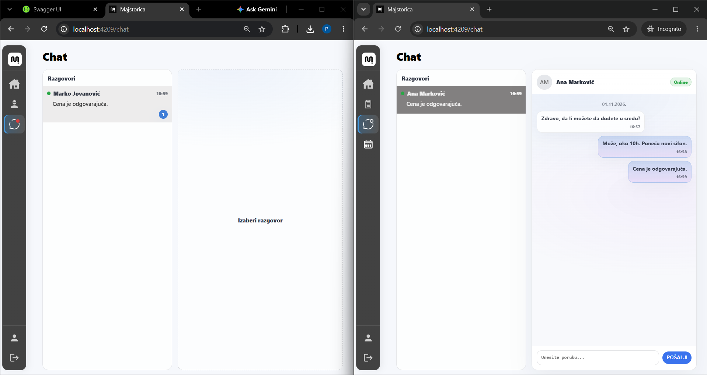

| Home | Find a master – search, filters, categories |
|------|---------------------------------------------|
| 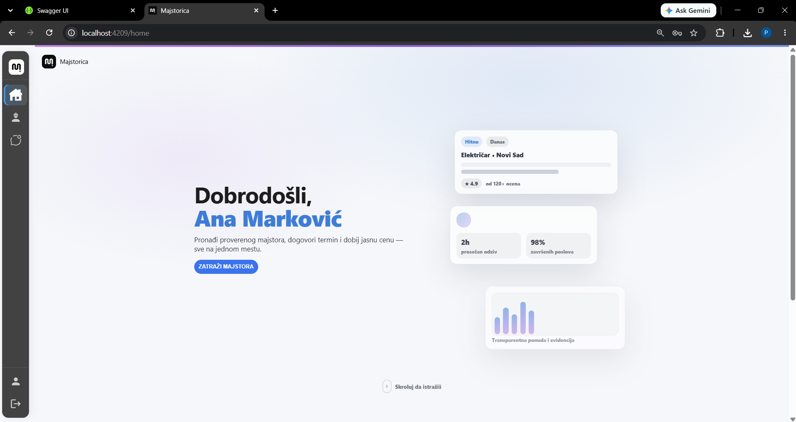 | 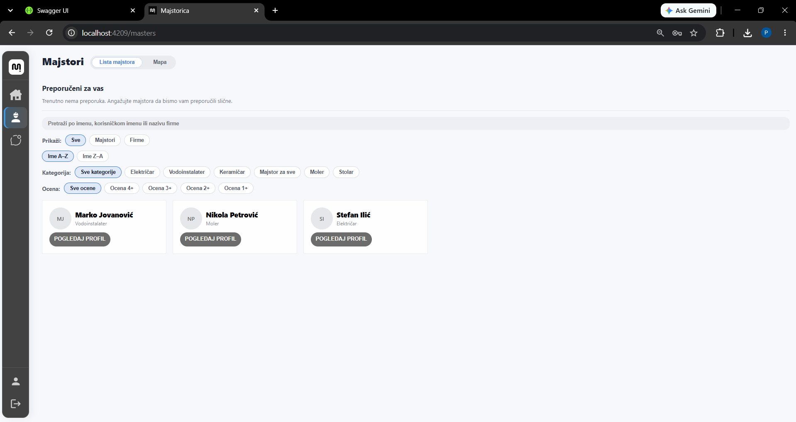 |

| Create a job request | Master's request dashboard – calendar and stats |
|----------------------|-------------------------------------------------|
| 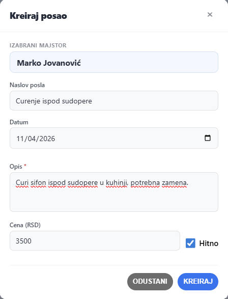 | 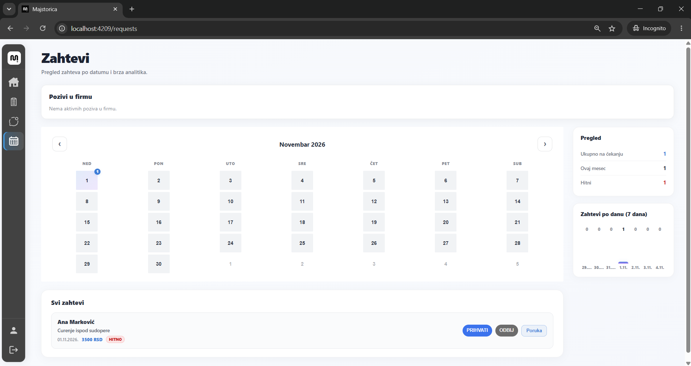 |

<details>
<summary><b>More screenshots</b></summary>

| Service categories | Master profile |
|--------------------|----------------|
| 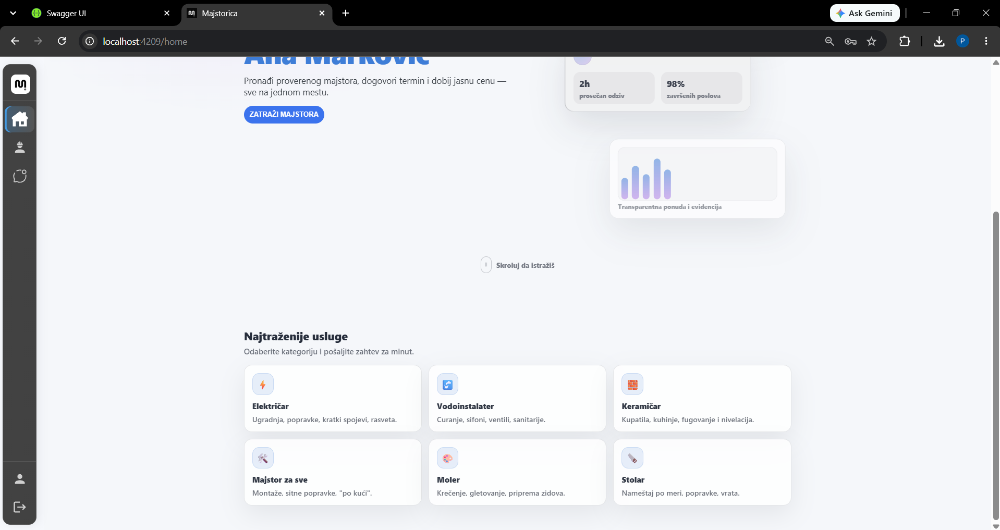 | 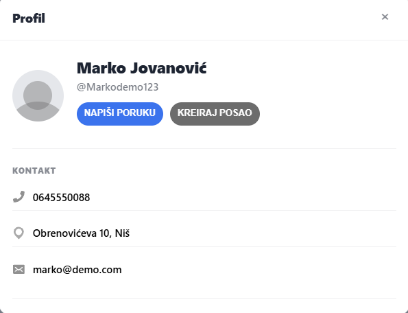 |

| Client profile – my jobs | Master profile – pending requests |
|--------------------------|-----------------------------------|
| 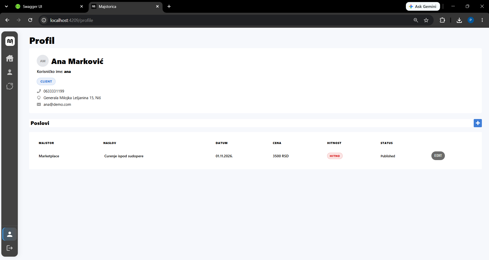 | 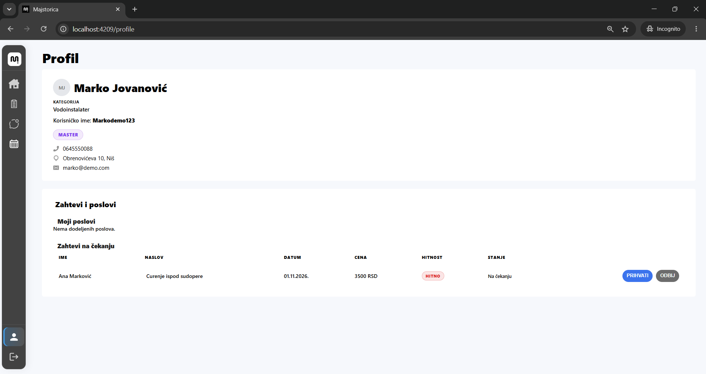 |

**Marketplace** – open jobs visible to masters and companies

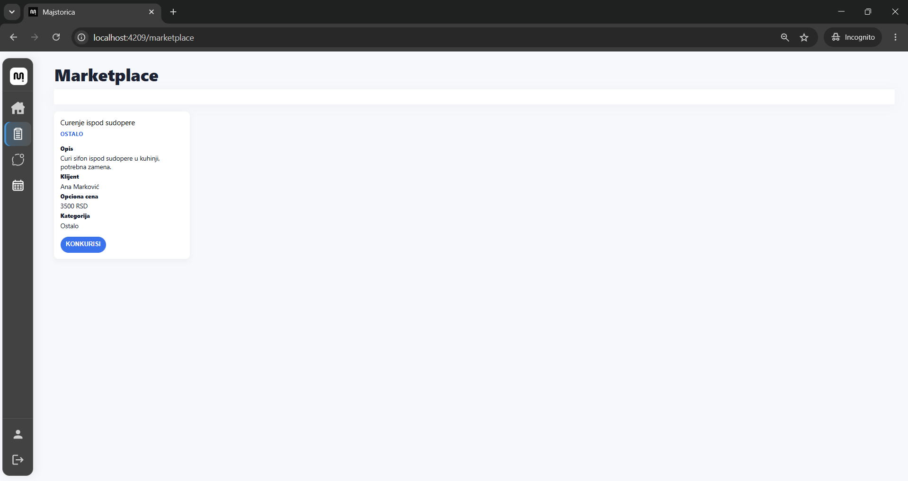

**API (Swagger)**

| Auth & Companies | Conversations & Jobs |
|------------------|----------------------|
| 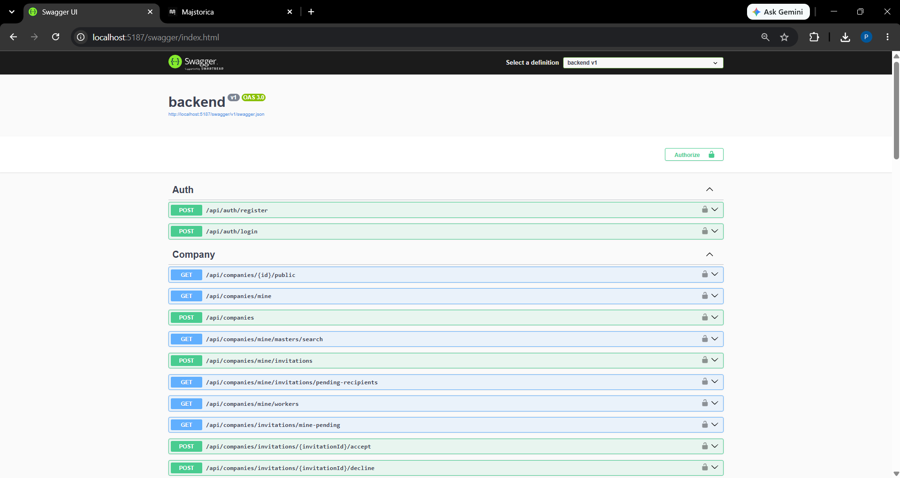 | 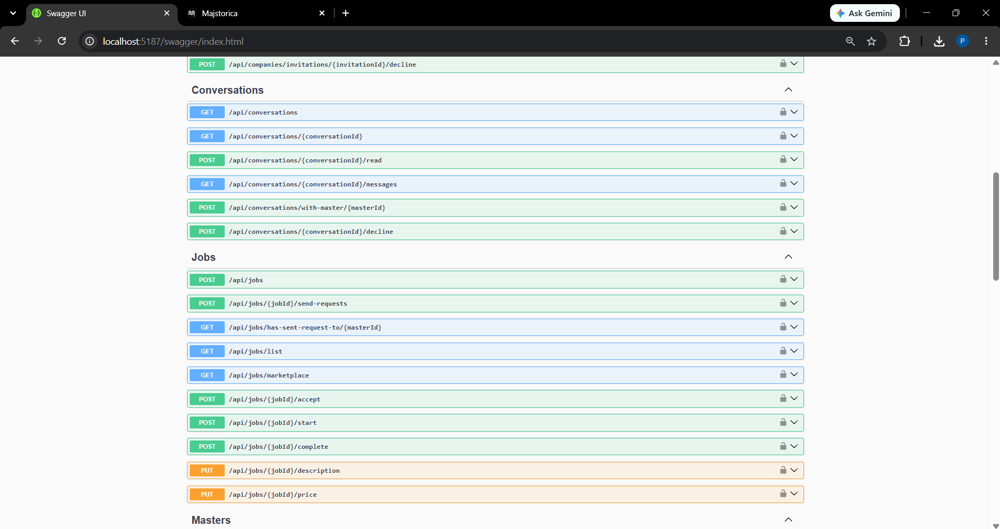 |

</details>

## Features

- **Roles** – client, master, company owner, company worker and admin, with JWT authentication and role-based navigation
- **Find a master** – search, filter by category and rating, sort, and personalised **recommendations** based on a graph of previously hired masters and their skills
- **Job requests** – clients create jobs (title, date, description, price, urgent flag) and send them directly to a master; masters accept or decline
- **Job lifecycle** – draft → published → assigned → in progress → completed, with cancellation and expiry
- **Marketplace** – masters and companies browse open jobs
- **Companies** – owners create a company, search for masters and invite them; masters accept or decline invitations
- **Real-time chat** – SignalR conversations with online/offline presence, unread counters and message history
- **Real-time notifications** – new job requests are published to RabbitMQ and pushed to the master via SignalR
- **Request dashboard** – calendar view of incoming requests with quick stats (pending, this month, urgent) and a 7-day chart

## Architecture

The backend follows a **layered / Domain-Driven Design** structure:

```text
Api              → Controllers, SignalR hubs, DTOs, global exception middleware
Application      → Services, interfaces, cache-key helpers, messages
Domain           → Entities, value objects, domain events, states, strategies, specifications
Infrastructure   → MongoDB, Redis, Neo4j repositories and RabbitMQ messaging
Shared           → JWT / password helpers, custom exceptions
```

### Polyglot persistence

Each database is used for what it does best:

| Store | Responsibility |
|-------|----------------|
| **MongoDB** | Main document store – users, master and client profiles, companies, invitations, jobs, conversations |
| **Redis** (Redis Stack) | User sessions and presence, chat messages (Redis OM with RedisJSON/RediSearch), list caching, distributed write locks per job, account activity |
| **Neo4j** | Graph of users, masters, skills, zones and jobs – powers master search and "recommended for you" (masters with the same skills as ones the client already hired) |
| **RabbitMQ** | Asynchronous messaging – new job requests are published and consumed by a hosted service that pushes them to clients over SignalR |

```text
Angular 19 (NgRx) ──HTTP / JWT──► ASP.NET Core Web API ──► MongoDB
        ▲                               │      │          ──► Redis
        │                               │      │          ──► Neo4j
        └────────── SignalR ◄───────────┘      └─► RabbitMQ ─┐
                       ▲                                     │
                       └──── RabbitMqSignalRHostedService ◄──┘
```

### Design patterns

| Pattern | Usage |
|---------|-------|
| **State** | Job lifecycle (`DraftState`, `PublishedState`, `AssignedState`, `InProgressState`, `CompletedState`, `CancelledState`, `ExpiredState`) – each state defines which transitions are allowed |
| **Strategy** | Assignment strategies (direct invitation vs. marketplace) and booking strategies (normal vs. emergency) |
| **Specification** | Reusable business rules – active job, available master, company eligible for a job |
| **Repository** | Separate repositories per store behind application-level interfaces |
| **Value Object** | `Money`, `Rating`, `Address`, `GeoLocation` |
| **Domain Events** | Job published / assigned / completed, application submitted, message sent, review created |

## API Overview

| Area | Endpoints |
|------|-----------|
| Auth | `POST /api/auth/register`, `POST /api/auth/login` |
| Masters | `GET /api/masters`, `GET /search`, `GET /recommended`, `GET /profile`, `PATCH /category` |
| Jobs | `POST /api/jobs`, `POST /{id}/send-requests`, `GET /list`, `GET /marketplace`, `POST /{id}/accept`, `/start`, `/complete`, `PUT /{id}/description`, `/price` |
| Conversations | `GET /api/conversations`, `GET /{id}/messages`, `POST /with-master/{masterId}`, `POST /{id}/read`, `/decline` |
| Companies | `POST /api/companies`, `GET /mine`, `GET /mine/masters/search`, `POST /mine/invitations`, `POST /invitations/{id}/accept`, `/decline` |
| User | `GET /api/user/{id}`, `PATCH /api/user/zone` |
| SignalR hub | `/hubs/document` – chat messages, presence, job groups and write locks |

Full interactive documentation is available in Swagger UI.

## Tech Stack

| Layer | Technologies |
|-------|--------------|
| Frontend | Angular 19, NgRx (store, effects, selectors), SCSS, Leaflet, SignalR client |
| Backend | ASP.NET Core 8 Web API, SignalR, JWT authentication, BCrypt, Swagger |
| Databases | MongoDB, Redis Stack (StackExchange.Redis, Redis OM), Neo4j |
| Messaging | RabbitMQ |
| DevOps | Docker Compose |

## Getting Started

### Prerequisites

- [Docker Desktop](https://www.docker.com/products/docker-desktop/)
- [.NET 8 SDK](https://dotnet.microsoft.com/download/dotnet/8.0)
- [Node.js](https://nodejs.org/) 18 or newer

### 1. Start the databases

```bash
docker compose up -d
```

This starts MongoDB (`27017`), Redis Stack (`6379`), Neo4j (`7474`, `7687`) and RabbitMQ (`5672`, management UI on `15672`). On Windows you can also run `.\start-databases.ps1`.

### 2. Run the backend

```bash
cd Application/backend
dotnet restore
dotnet run
```

The API runs at `http://localhost:5187` (Swagger: `http://localhost:5187/swagger`).

### 3. Run the frontend

```bash
cd Application/frontend
npm install
npx ng serve --port 4209
```

Open `http://localhost:4209`. The backend's CORS policy allows ports `4200` and `4209`.

> Local configuration (database connections, JWT settings) is in `Application/backend/appsettings.json`. The values there are development defaults for the Docker setup only.

## Project Structure

```text
majstorica/
├── Application/
│   ├── backend/            # ASP.NET Core Web API (Api, Application, Domain, Infrastructure, Shared)
│   └── frontend/           # Angular 19 + NgRx client
├── Documents/              # Architecture and design documentation (Serbian)
├── docs/screenshots/       # README images
├── docker-compose.yml      # MongoDB, Redis Stack, Neo4j, RabbitMQ
└── start-databases.ps1     # Windows helper script for the databases
```

## Team

- **Petar Nikolić** – [@petarNi](https://github.com/petarNi) – backend and databases (MongoDB, Redis, Neo4j, RabbitMQ)
- **Luka Dimić** – [@dimicl](https://github.com/dimicl)
